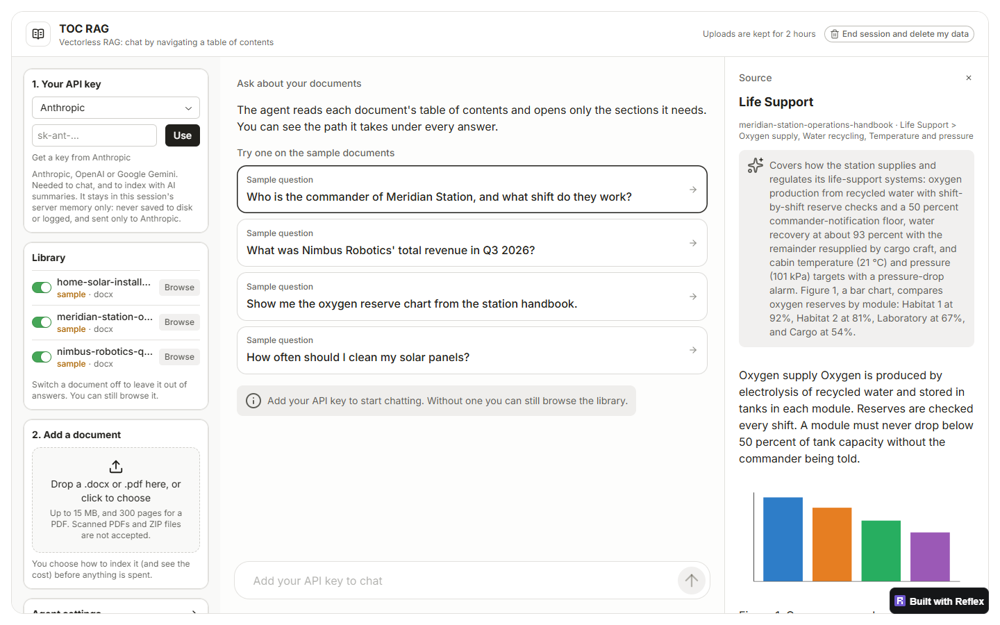

# TOC RAG

**Retrieval without vectors.** An AI agent answers questions about your documents by navigating their table of contents, the way a person would: open the document, scan the outline, step into the right section, read it, and cite it. No chunking, no embeddings, no similarity search.

**[Try it live →](https://toc-rag.up.railway.app)** Bring an Anthropic, OpenAI or Google Gemini key, or browse the sample library without one.



## How it works

1. **Index once.** Each document becomes a tree of sections built from its own structure: Word headings, PDF bookmarks, a printed contents page, or lines formatted like headings. Sections too big to read in one go are split, runs of tiny ones are merged, and the original outline is kept wherever it is already good.
2. **Summarise.** A small model writes a summary of every section, saying what questions it can answer, and describes the charts and pictures. (Or skip this: the free preset shows each section's first sentences instead, with no model calls at all.)
3. **Navigate.** For each question the agent gets a few tools (open a document, list a section's subsections, read a section, go back up) and walks the tree, choosing branches by their summaries.
4. **Cite.** Each claim in the answer names the section it came from. A citation is only kept if the agent actually read that section, so the app never shows a source the model only guessed at.

### Why not vector RAG?

| | Vector RAG | TOC RAG |
| --- | --- | --- |
| Finds text by | similarity of embedded chunks | following the document's own structure |
| Context the model sees | isolated chunks | whole sections, in their place in the outline |
| Explains its choice | no (a similarity score) | yes: every step of the path is shown |
| Needs | an embedding model and a vector store | nothing beyond the chat model |

The trade-off: navigation takes a few model calls per question, and it works best on documents with a sensible structure. Measuring the two side by side on accuracy, cost and speed is on the roadmap.

## Features

- **Bring your own key** for Anthropic, OpenAI or Google Gemini. The app lists the models your key can use; you pick one for indexing and one for chat.
- **Word and PDF**, with or without a table of contents. PDF answers cite printed page numbers and can show the pages themselves; charts and pictures become images the answer can show; ruled tables and two-column layouts are read properly.
- **See the cost first.** Three presets, Free, Budget and Full, each with an estimate of model calls and tokens before anything is spent, plus advanced options for how the tree is shaped.
- **Watch it think.** The agent's path streams live as it works, then the answer, with citations that open the source section and pictures shown inline.
- **Choose what it reads.** Switch any document, sample or yours, out of answers without deleting it. Your first upload switches the samples off so answers come from your document.

## Privacy and security

This is a public app that handles other people's API keys and documents, so:

- **Your key** stays in server memory for your session only. It is never written to disk, sent to the browser or saved with an index, and every log line is scrubbed of anything that looks like a key.
- **Your documents** live in a private folder for your session, deleted when you end it or after 2 hours. Uploads must really be PDF or Word files (checked by content, not name), with size, page and zip-bomb limits.
- **Abuse limits:** per-visitor rate limits, a cap on documents read at once, and each document is read in its own process with a time limit, so a hostile file can't stall the server.
- **The usual hardening:** a content security policy that allows pictures and connections only from the app itself, no framing by other sites, CORS locked to the app's address, and pinned, audited dependencies.

## Run it locally

Needs Python 3.11+ and Node 22.22 or newer (for the Reflex frontend).

```bash
python -m venv .venv
.venv/Scripts/pip install -c constraints.txt -e ".[dev,app]"     # macOS/Linux: .venv/bin/pip
reflex run
```

Open <http://localhost:3000>, then **Open the app** and paste an API key. No `.env` is needed: the web app only uses the key you enter.

Or with Docker: `docker compose up --build`, then open <http://localhost:8000>. To host it yourself, see [docs/deploying.md](docs/deploying.md).

## Tests

```bash
.venv/Scripts/python -m pytest                # unit tests, no API key needed
.venv/Scripts/python tests/e2e/run_e2e.py     # the whole app in a real Chrome, with an offline stand-in model
```

The end-to-end run drives the app like a visitor would (key, uploads, indexing, chat, citations, switching documents, ending the session) and saves a screenshot of each step.

## Project layout

```text
src/toc_rag/
  indexing/     Word / PDF -> section tree -> refine (split, merge) -> summaries
  agent/        the navigation tools and the LangGraph agent loop
  providers.py  Anthropic, OpenAI and Gemini: models and model lists
toc_app/        the Reflex web app
tests/          unit tests, the offline stand-in model, the end-to-end browser run
samples/        the sample documents and their indexes
```

## Documentation

- [DESIGN.md](DESIGN.md): the design, its decisions and the roadmap.
- [docs/walkthrough/](docs/walkthrough/00-start-here.md): a guided tour of every module.
- [docs/deploying.md](docs/deploying.md): hosting it yourself, and every setting.

## Roadmap

- An evaluation against a vector-RAG baseline: accuracy, tokens and speed.
- Generated structure for documents with no usable outline.
- Letting the agent look at pictures, not only their descriptions.

## Credits

Inspired by [PageIndex](https://github.com/VectifyAI/PageIndex) by VectifyAI; an independent project, not affiliated with VectifyAI. Built with [Reflex](https://reflex.dev), [LangGraph](https://www.langchain.com/langgraph) and [LangChain](https://www.langchain.com). PDFs are read with [pypdfium2](https://github.com/pypdfium2-team/pypdfium2) and [pdfplumber](https://github.com/jsvine/pdfplumber).

<!-- Licence: none chosen yet. Add a LICENSE file and a line here when it is. -->
